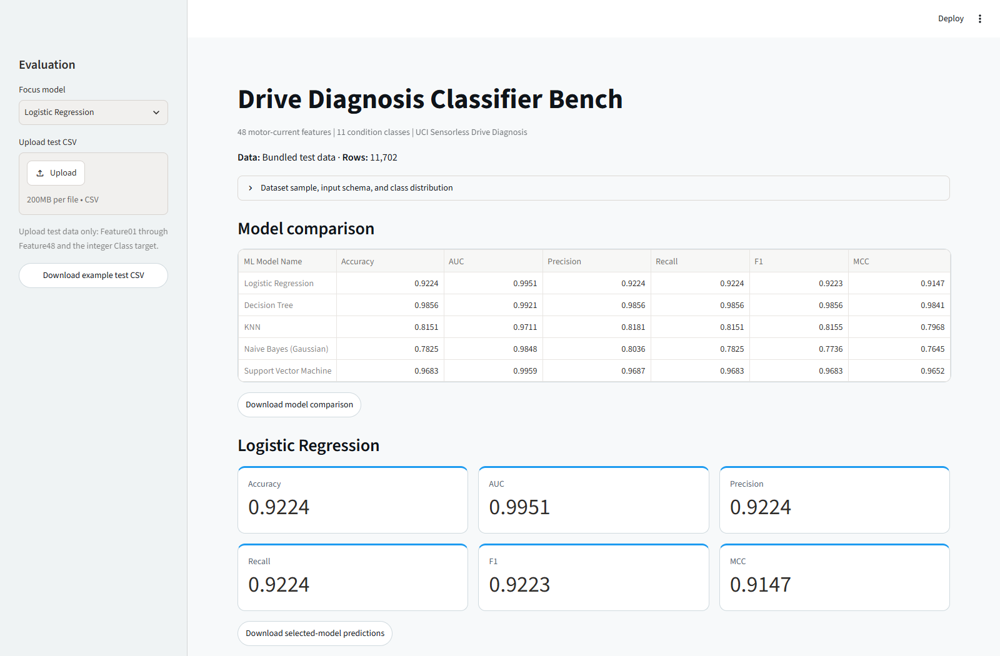
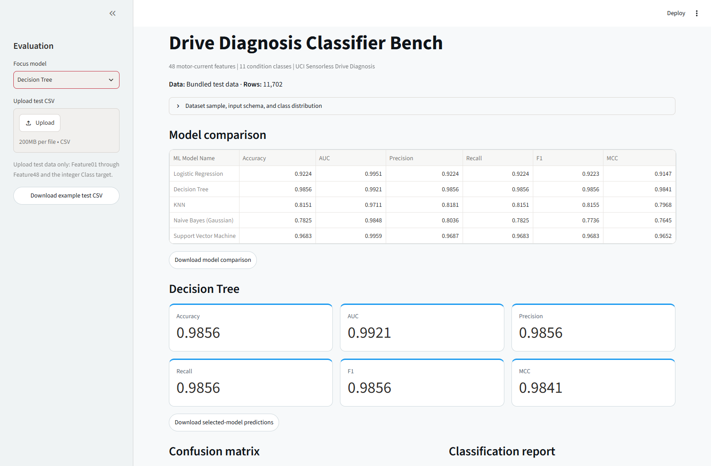
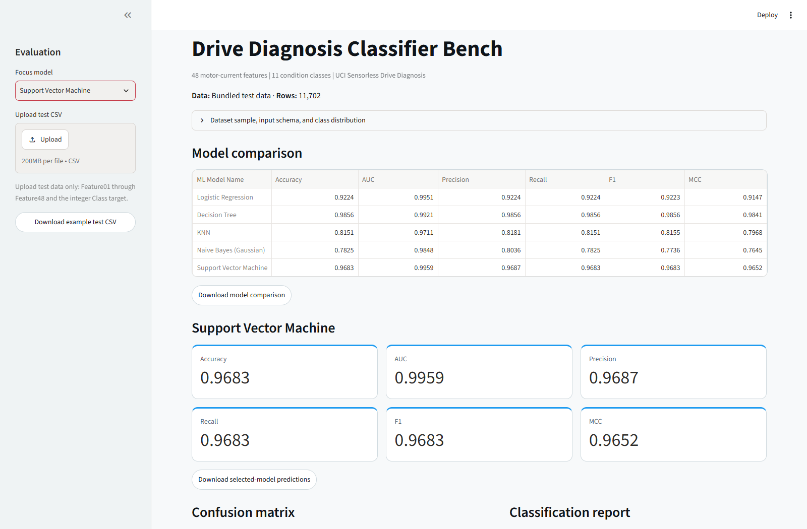
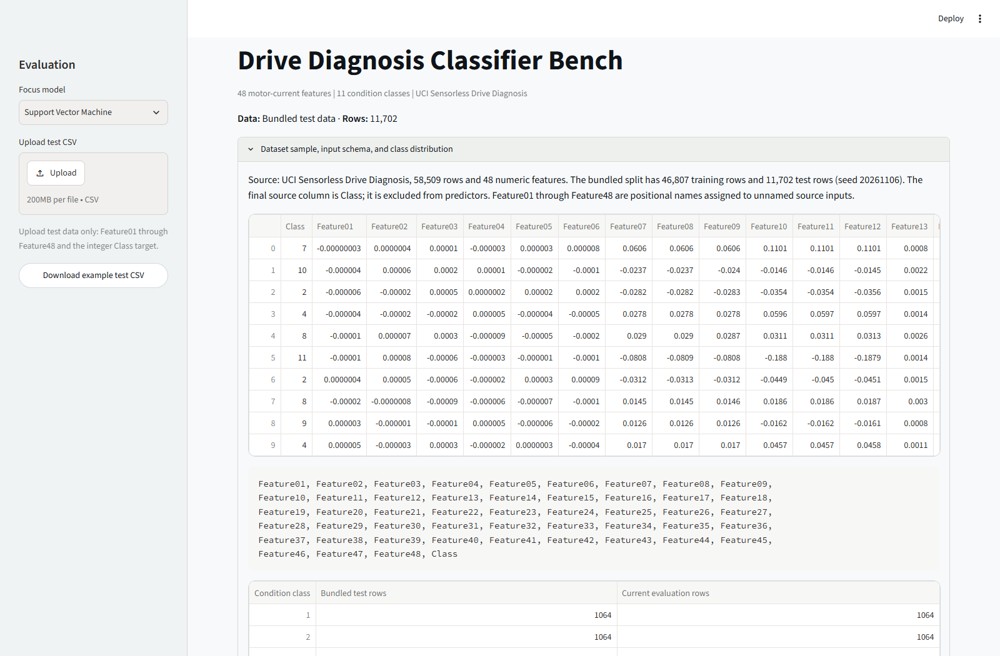
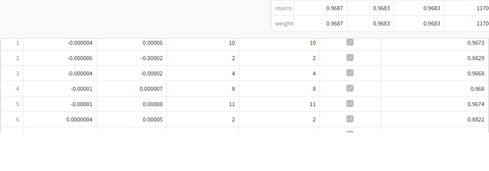
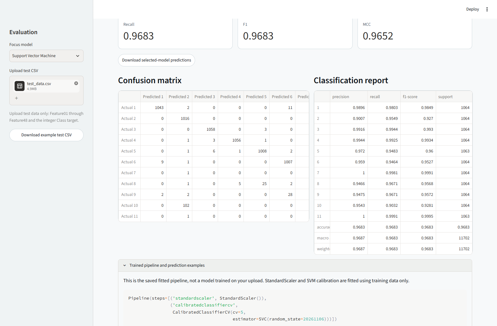

## Problem Statement

Predict one of 11 drive-condition classes from 48 features extracted from motor
current signals. Train the five required classifiers on the same training rows,
evaluate six metrics on the same held-out test rows, and inspect predictions in
a Streamlit application. This is classification of supplied tabular features,
not processing of live motor signals or a deployed safety-monitoring system.

## Dataset Description

The [UCI Dataset for Sensorless Drive Diagnosis](https://archive.ics.uci.edu/dataset/325/sensorless+drive+diagnosis)
contains 58,509 records. The downloaded file was verified to contain 48 numeric
input columns plus one integer target column. It exceeds the assignment minimums
of 500 instances and 12 features. UCI reports no missing values; preparation also
checks for missing and non-finite values. No exact duplicate full records were
found. The full dataset is used, with no sampling or reduction in feature count.

UCI describes intact and defective motor components measured repeatedly under
12 operating conditions involving speed, load moment, and load force. Features
were extracted from two-phase current signals using empirical mode decomposition
(EMD), intrinsic mode functions and residuals, and statistical summaries such as
mean, standard deviation, skewness, and kurtosis.

The source file, `Sensorless_drive_diagnosis.txt`, has no header. Its first 48
columns become `Feature01` through `Feature48`, preserving source order. These
are project-assigned positional names, not official physical feature names.
The final column becomes `Class`. The target is excluded from model inputs.
The available metadata does not establish an exact per-column physical mapping
or a reliable fault-name mapping for each class code, so neither is invented.

The exact CSV feature names are:

```text
Feature01,Feature02,Feature03,Feature04,Feature05,Feature06,Feature07,Feature08,Feature09,Feature10,Feature11,Feature12,Feature13,Feature14,Feature15,Feature16,Feature17,Feature18,Feature19,Feature20,Feature21,Feature22,Feature23,Feature24,Feature25,Feature26,Feature27,Feature28,Feature29,Feature30,Feature31,Feature32,Feature33,Feature34,Feature35,Feature36,Feature37,Feature38,Feature39,Feature40,Feature41,Feature42,Feature43,Feature44,Feature45,Feature46,Feature47,Feature48
```

Append `Class`, with integer codes from 1 through 11. Preserve column names and
source order when preparing upload data.

### Split and Class Distribution

A stratified 80/20 split with random state `20261106` produces 46,807 training
records and 11,702 test records. Each original class contains exactly 5,319
records; rounding creates a one-record difference in the split counts.

| Condition class | Total rows | Training rows | Test rows |
|-----------------|------------|---------------|-----------|
| 1 | 5,319 | 4,255 | 1,064 |
| 2 | 5,319 | 4,255 | 1,064 |
| 3 | 5,319 | 4,255 | 1,064 |
| 4 | 5,319 | 4,255 | 1,064 |
| 5 | 5,319 | 4,256 | 1,063 |
| 6 | 5,319 | 4,255 | 1,064 |
| 7 | 5,319 | 4,255 | 1,064 |
| 8 | 5,319 | 4,255 | 1,064 |
| 9 | 5,319 | 4,255 | 1,064 |
| 10 | 5,319 | 4,255 | 1,064 |
| 11 | 5,319 | 4,256 | 1,063 |
| Total | 58,509 | 46,807 | 11,702 |

Always predicting one of the largest test classes yields 1,064/11,702 = 0.0909
accuracy. Macro metrics give each condition equal weight; balanced class counts
make macro recall close to accuracy, but precision and F1 can still differ.

### Example Input Records

The first five actual rows of [test_data.csv](./test_data.csv), with four of the
48 input features shown in scientific notation:

| Feature01 | Feature02 | Feature03 | Feature04 | Class |
|-----------|-----------|-----------|-----------|-------|
| -3.9621e-08 | 4.4180e-07 | 1.4261e-05 | -3.1874e-06 | 7 |
| -3.5416e-06 | 6.3153e-05 | 2.4527e-04 | 1.2673e-05 | 10 |
| -5.5443e-06 | -1.6878e-05 | 4.6425e-05 | 2.6462e-07 | 2 |
| -3.9820e-06 | -2.3080e-05 | -2.0704e-05 | 5.3406e-06 | 4 |
| -1.3885e-05 | 7.1854e-06 | 3.0758e-04 | -9.2797e-06 | 8 |

### Dataset Selection

Sensorless Drive Diagnosis was selected for its engineering interpretation,
48-feature input space, balanced 11-class target, and larger number of records.
The following official sources were considered; this is a suitability comparison,
not an experiment on those alternatives or a survey of classmates' datasets.

| Dataset | Rows | Features | Classes | Consideration |
|---------|------|----------|---------|---------------|
| [Sensorless Drive Diagnosis](https://archive.ics.uci.edu/dataset/325/sensorless+drive+diagnosis) | 58,509 | 48 verified | 11 | Selected: motor-current condition classification with balanced classes. |
| [Steel Plates Faults](https://archive.ics.uci.edu/dataset/198/steel+plates+faults) | 1,941 | 27 | 7 | Smaller industrial dataset; superseded at the user's request. |
| [Image Segmentation](https://archive.ics.uci.edu/dataset/50/image+segmentation) | 2,310 | 19 | 7 | Suitable dimensions, but regions originate from only seven images. |
| [Landsat Satellite](https://archive.ics.uci.edu/dataset/146/statlog+landsat+satellite) | 6,435 | 36 | 6 observed | Suitable dimensions; spatially related neighborhoods and no examples of class 6. |

Dataset popularity among other submissions is unknown. Choosing another public
dataset does not establish originality. All CSVs, models, metrics, screenshots,
and reports in this experiment replace the earlier Steel Plates/Dry Bean work;
their scores are not reused.

Citation: Bator, M. (2013). Dataset for Sensorless Drive Diagnosis [Dataset].
UCI Machine Learning Repository.
[DOI: 10.24432/C5VP5F](https://doi.org/10.24432/C5VP5F).
Licensed under [CC BY 4.0](https://creativecommons.org/licenses/by/4.0/).

## GitHub Repository Link

[GitHub Repository](https://github.com/2026ak05140-dev/MLAssignment2)

```text
MLAssignment2/
|-- app.py
|-- prepare_data.py
|-- train_models.py
|-- test_project.py
|-- requirements.txt
|-- README.md
|-- test_data.csv
|-- model_metrics.csv
|-- model/
    |-- logistic_regression.joblib
    |-- decision_tree.joblib
    |-- knn.joblib
    |-- gaussian_naive_bayes.joblib
    |-- support_vector_machine.joblib
```

The training CSV is generated locally and excluded from Git. Regenerate it
before retraining or running the regression tests.

The public repository was accessible during verification on 2026-11-08.
Its published README differed from the local Sensorless Drive README.
The current local changes still need to be committed and published; an accessible
repository link alone does not prove the latest experiment is available there.

## Models Used

All five models use 46,807 training rows and 11,702 held-out test rows.
Hyperparameters are fixed baselines, not selected by optimizing test scores.

### Pipeline Configurations

| Model | Preprocessing | Estimator configuration |
|-------|---------------|-------------------------|
| Logistic Regression | StandardScaler fitted on training rows | C=1.0, L2 regularization, solver=lbfgs, max_iter=2000, random_state=20261106 |
| Decision Tree | None | criterion=gini, max_depth=None, min_samples_split=2, min_samples_leaf=1, random_state=20261106 |
| KNN | StandardScaler fitted on training rows | n_neighbors=5, weights=uniform, metric=minkowski, p=2 |
| Naive Bayes (Gaussian) | None | GaussianNB, var_smoothing=1e-9 |
| Support Vector Machine | StandardScaler fitted on training rows | SVC with C=1.0, kernel=rbf, gamma=scale, random_state=20261106; CalibratedClassifierCV with method=sigmoid, cv=5 |

Scaling makes Logistic Regression regularization and KNN/SVM distance calculations
less dependent on input magnitudes. Trees split on individual feature thresholds
and do not require scaling. SVM probability calibration uses training folds only,
not test records; the saved estimator is a calibrated cross-validation pipeline.

### Held-Out Results

Precision, recall, and F1 use macro averaging. AUC is macro one-vs-rest AUC from
binarized class labels and predicted probabilities. MCC is multiclass Matthews
correlation coefficient. [model_metrics.csv](./model_metrics.csv) stores full
precision; the report displays four decimal places.

| ML Model Name | Accuracy | AUC | Precision | Recall | F1 | MCC |
|---------------|----------|-----|-----------|--------|----|-----|
| Logistic Regression | 0.9224 | 0.9951 | 0.9224 | 0.9224 | 0.9223 | 0.9147 |
| Decision Tree | 0.9856 | 0.9921 | 0.9856 | 0.9856 | 0.9856 | 0.9841 |
| KNN | 0.8151 | 0.9711 | 0.8181 | 0.8151 | 0.8155 | 0.7968 |
| Naive Bayes (Gaussian) | 0.7825 | 0.9848 | 0.8036 | 0.7825 | 0.7736 | 0.7645 |
| Support Vector Machine | 0.9683 | 0.9959 | 0.9687 | 0.9683 | 0.9683 | 0.9652 |

### Model Observations

| ML Model Name | Observation about model performance |
|---------------|-------------------------------------|
| Logistic Regression | Accuracy is 0.9224 and AUC is 0.9951. Linear decision boundaries give a strong baseline but lag Tree and SVM on final class decisions. Standardization keeps regularization from depending primarily on measurement magnitude. |
| Decision Tree | Leads accuracy, precision, recall, F1 (all approximately 0.9856), and MCC (0.9841). Feature-specific threshold rules work well on this split. The fitted tree has depth 35 and 613 leaves. Its lower AUC than SVM reflects weaker probability ranking despite better final predictions. An unrestricted tree's variance remains a risk, not a demonstrated failure on this test set. |
| KNN | Accuracy is 0.8151, macro F1 is 0.8155, and AUC is 0.9711. Scaling prevents large-valued features from dominating Euclidean distances, but uniform five-neighbor voting in 48 dimensions can still struggle with redundant dimensions or overlapping neighborhoods. No dimensionality-reduction or neighbor-count ablation was performed. |
| Naive Bayes (Gaussian) | Lowest accuracy (0.7825), F1 (0.7736), and MCC (0.7645), although AUC is 0.9848. Probability ranking can remain useful while final class decisions are weaker. Current-signal statistical summaries may be dependent and non-Gaussian, challenging its assumptions. Those explanations are hypotheses, not verified causal findings. |
| Support Vector Machine | Second-highest accuracy (0.9683) and macro F1 (0.9683), and highest AUC (0.9959). Standardized RBF distances allow nonlinear separation, and training-only sigmoid calibration supplies class probabilities. Five-fold calibration increases training and inference costs compared with a single model. |
| Overall winner for this dataset | Decision Tree on this fixed split, based on the highest label-based metrics and MCC. SVM leads AUC, which evaluates probability ranking rather than final predicted labels. No repeated-split evaluation or significance test establishes universal superiority. |

Decision Tree correctly classifies 11,533 of 11,702 test records. Per-class recall
ranges from 0.9727 (class 5) to 1.0000 (classes 7 and 11). The high aggregate score
is therefore not confined to one dominant class, but perfect class recall on
this split does not guarantee performance on future measurements.

The record-level random split does not demonstrate generalization to a new motor,
unseen operating condition, or independent measurement session. UCI reports
repeated measurements under multiple operating conditions, but the published
table does not provide a verified session/group identifier for a grouped split.
High held-out scores must be interpreted within that limitation.

## Application Architecture

The project separates source-data preparation, model training, and interactive
evaluation so the Streamlit app never fits a model from an uploaded test file.

1. [prepare_data.py](./prepare_data.py) downloads the original UCI archive,
   verifies its schema and values, assigns names to the 48 features, and writes
   a stratified training/test split.
2. [train_models.py](./train_models.py) validates both CSVs, builds five
   scikit-learn pipelines, fits each pipeline on training rows, and evaluates
   it on the held-out test rows. It saves the fitted pipelines under `model/`
   and writes full-precision metrics to `model_metrics.csv`.
3. [app.py](./app.py) reads the bundled test data and saved pipelines. A user
   can keep the bundled test set or upload a labeled CSV with the same feature
   schema. The app checks columns, numeric feature values, missing values, and
   class labels before evaluating all five models.
4. The app displays the comparison, metrics for the selected focus model, its
   confusion matrix and classification report, and example predictions. It can
   download the example test CSV, metric comparison, and selected-model
   predictions. Upload evaluation does not retrain or overwrite model files.

Streamlit caches the bundled test data and loaded model objects. Model
comparisons are cached by evaluation data and saved-model modification times,
so changing the focus model does not repeat inference across all test rows.
`test_project.py` checks data parsing, split and model invariants, saved metrics,
and each model selection in the Streamlit app.

## Experiment Workflow

1. Install pinned dependencies in Python 3.11.
2. Run [prepare_data.py](./prepare_data.py) to download the full UCI source,
   validate 49 columns, assign positional feature names, and make a stratified
   training/test split.
3. Run [train_models.py](./train_models.py) to fit all five pipelines on training
   rows only. Scaling and SVM calibration never use held-out test rows.
4. Calculate six test metrics and save fitted pipelines and full-precision results.
5. Run [test_project.py](./test_project.py) to validate source parsing, labels,
   split separation, scalers, saved metrics, and all five UI model selections.
6. Start [app.py](./app.py) and inspect sample data, class counts, the comparison,
   selected model metrics, confusion matrix, classification report, and predictions.
7. Upload labeled test data only. The app performs inference without retraining.
   Comparisons are cached by input data and model modification times so selecting
   a different model does not repeat full-dataset inference.
8. Publish the replacement artifacts, redeploy, verify both public links, and
   assemble the final PDF with genuine BITS Virtual Lab evidence if available.

### Software and Data Preparation

Use Python 3.11 with the exact package versions in
[requirements.txt](./requirements.txt). The app and training scripts use pandas
for CSV handling, NumPy for numeric checks, scikit-learn for pipelines and
metrics, joblib for saved models, and Streamlit for the interface. Internet
access is needed to run `prepare_data.py`; the app itself uses the bundled test
CSV and saved models.

Data preparation is deterministic: the script downloads the original UCI ZIP,
checks its row and column counts, rejects missing or non-finite values, assigns
the 48 positional feature names, then creates a stratified 80/20 split using
random state `20261106`. There is no imputation, row removal, feature selection,
or additional feature transformation. `StandardScaler` is fitted inside the
Logistic Regression, KNN, and SVM pipelines using training rows only. The tree
and Gaussian Naive Bayes pipelines do not scale features. The held-out test
split is used for reporting, not fitting.

These are fixed baseline configurations, not fine-tuned results: no grid search
or parameter search was run. The estimator settings are listed under
[Pipeline Configurations](#pipeline-configurations). To change a setting,
update `build_models()` in [train_models.py](./train_models.py), retrain, and
report the result on the same held-out split only as a comparison; do not use
that split to choose settings and then present it as an untouched final test.

## Reproduce the Local Run

```powershell
uv venv .venv --python 3.11
uv pip install --python .venv\Scripts\python.exe -r requirements.txt
.venv\Scripts\python.exe prepare_data.py
.venv\Scripts\python.exe train_models.py
.venv\Scripts\python.exe -m unittest test_project -v
.venv\Scripts\python.exe -m streamlit run app.py
```

Training on the full dataset, particularly five-fold calibrated SVM, takes
longer than the earlier smaller datasets. The first app evaluation also performs
inference for all five models; subsequent focus changes reuse cached comparisons.
The latest verification on 2026-11-08 completed all six regression tests in
approximately 161 seconds, including one full-data app comparison. Earlier
runs took approximately 61 and 334 seconds, demonstrating that elapsed time varies
with machine load and cache state. Public cloud runtime and memory limits still
need verification; local timing does not certify acceptable cloud response time.

Use pinned dependencies, including `scikit-learn==1.9.1`, to reproduce the saved
models. Another scikit-learn version may warn or fail to reproduce behavior.

## Common Troubleshooting

### UCI Download or Dataset Preparation Fails

`prepare_data.py` needs network access to the UCI archive. If the request times
out or the archive cannot be reached, check the network and try again. The
repository includes `test_data.csv` and fitted models for running the app; the
training data file is generated locally and ignored by Git. To regenerate the
split for retraining or regression tests, run:

```powershell
.\.venv\Scripts\python.exe prepare_data.py
```

### Uploaded CSV Is Rejected

The upload must be a labeled test set with columns `Feature01` through
`Feature48` in that order, followed by `Class`. Keep values numeric and finite,
remove missing cells, and use class codes 1 through 11. Evaluation requires all
11 classes so multiclass AUC can be calculated. Use the app's example CSV to
check the expected column names and order.

### Saved Model Is Missing or Does Not Match the Data

The app loads the five `.joblib` files from `model/` and checks each pipeline's
feature names and class labels before evaluation. Restore the complete `model/`
folder from the repository. If models need to be rebuilt, first regenerate
`train_data.csv` and `test_data.csv`, then run:

```powershell
.\.venv\Scripts\python.exe train_models.py
```

### Model Loading Warns or Fails After Installing Packages

Install the pinned packages from `requirements.txt` in the same Python
environment used to run Streamlit. The saved scikit-learn pipelines may not be
compatible with other scikit-learn versions.

### The First App Evaluation Takes a While

On its first run, the app evaluates five saved models across the selected test
data. The calibrated SVM can take longer than the other pipelines. Later focus
model changes reuse cached comparisons. For a smaller trial, prepare a separate
labeled CSV that still contains all 11 classes and the full 49-column schema.

### Streamlit Community Cloud Does Not Start the App

Confirm that the deployed branch contains `app.py`, `requirements.txt`, all
five files in `model/`, and `test_data.csv`. Check the Cloud app logs for the
first import or model-loading error, then confirm the deployment points to the
correct repository, branch, and app file. Local success does not confirm that
the public deployment is current or reachable.

For BITS Virtual Lab, install the same dependencies and run preparation, training,
and the app there. If downloads are blocked, transfer the generated CSVs and
run training in the lab. Capture genuine lab execution evidence.

## Streamlit App

The intended public link is
[Drive Diagnosis Classifier Bench](https://mlassignment2-nz97nufqwetuqsaxhdjt6c.streamlit.app/).
During verification on 2026-11-08, the browser was redirected to a network
"Site Blocked" page; a separate fetch returned HTTP 403. This prevents verification
from this environment and does not establish whether the deployed application
itself is unavailable. Local artifacts are not published automatically.
Commit/push, redeploy, and check the URL from an allowed network before submission.

The app provides:

* Test CSV upload with 48 numeric features and the integer `Class` target.
* Five-model comparison, focus-model selection, and six evaluation metrics.
* An 11-class confusion matrix and classification report.
* Actual input samples, exact schema, and evaluation class distribution.
* The fitted pipeline and ten actual-versus-predicted examples with estimated
  maximum class probabilities, which are not guarantees of correctness.
* Downloads for the example test CSV, model comparison, and selected model's
  row-level predictions.

All condition classes 1 through 11 must be present in the evaluation CSV.
Missing required columns, missing/non-finite values, nonnumeric inputs, and
unknown/noninteger classes are rejected explicitly.

## Submission Checklist

The final PDF must contain:

1. GitHub repository link with source, dependencies, README, saved models, and
   experiment test CSV.
2. A working live Streamlit app link.
3. One genuine BITS Virtual Lab execution screenshot.
4. The GitHub README content.

> [!IMPORTANT]
> Local screenshots are not BITS Virtual Lab evidence. Without genuine lab
> evidence, the backup does not meet the 1-mark execution requirement. An
> inaccessible public app may affect additional deployment-related marks.

Review and understand the implementation before submission. The assignment
permits AI for learning support, not direct copy-paste submissions. Retain
genuine commit history; a dataset change does not prove originality.

### Guideline Verification

These checks apply to the current local Sensorless Drive experiment. They are
not a guarantee of marks or a certification of originality.

| Assignment requirement | Verification result |
|------------------------|---------------------|
| One public classification dataset, at least 500 instances and 12 features | Verified: UCI Sensorless Drive Diagnosis, 58,509 records, 48 inputs, and 11 classes. |
| Five required classifiers on the same dataset | Verified: Logistic Regression, Decision Tree, KNN, Gaussian Naive Bayes, and RBF SVM use the same 46,807 training and 11,702 test records. |
| Six metrics for every classifier | Verified: all 30 saved values match app calculations to a tolerance of 1e-12; the README table matches their four-decimal rounding. |
| Observations for every model and an overall winner | Included: five analytical observations, Decision Tree winner, and evaluation limitations. |
| Source, dependencies, test CSV, and five saved models | Present locally. Public repository is accessible, but the current local revision has not been published. |
| Test CSV upload without retraining | Verified in the browser using the bundled test CSV; missing-feature input is rejected explicitly. Model files are unchanged by inference. |
| Model dropdown, comparison, six metrics, confusion matrix/report | Verified for all five choices in regression tests and shown in fresh local screenshots. |
| Single PDF ordered as repository link, live app link, BITS evidence, README | Backup uses these section positions; the BITS section states that genuine lab evidence is unavailable. Word is an editing copy, not the final submission format. |
| Live Streamlit app opens an interactive frontend | Not verified: this environment blocks the public URL. Check the redeployed app from an allowed network. |
| One genuine BITS Virtual Lab screenshot | Not fulfilled: all included images are explicitly local evidence. Replace the evidence section after a genuine lab run. |
| Academic integrity and genuine history | Must be reviewed by the author; tests and a dataset change cannot establish originality or compliance with the AI-use policy. |

Before final submission, publish the current artifacts, verify the live app,
replace the evidence section if a BITS run succeeds, and export the edited Word
document as a single PDF. Recheck the PDF links and tables after any manual edits.

### Local Backup Evidence

The [backup PDF](./submission-backup.pdf) and
[editable Word backup](./submission-backup.docx) contain the current experiment.
Replace the local execution section with genuine BITS evidence if a run succeeds.

All screenshots below were refreshed from genuine local execution on 2026-11-08.
They show the same Sensorless Drive test split and models as the result table.












